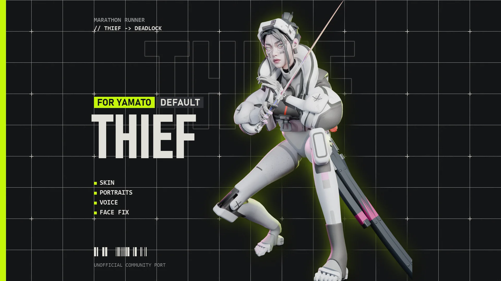
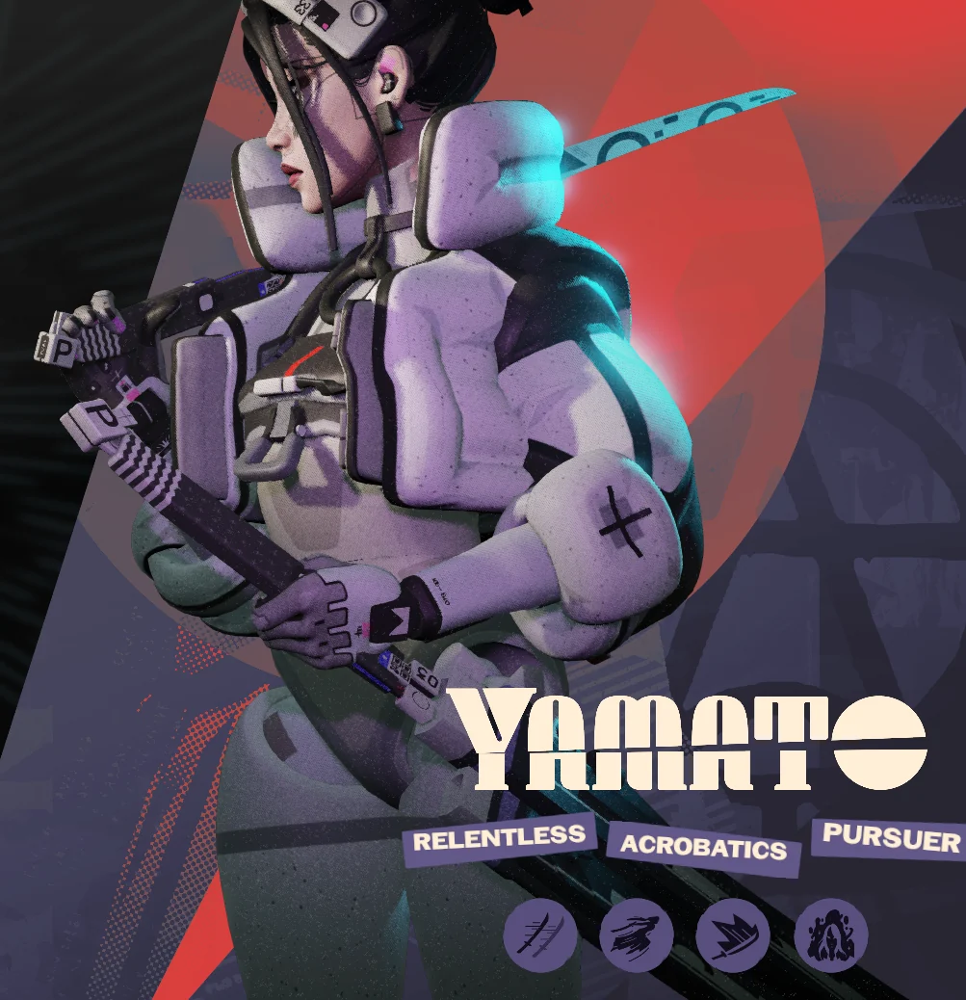
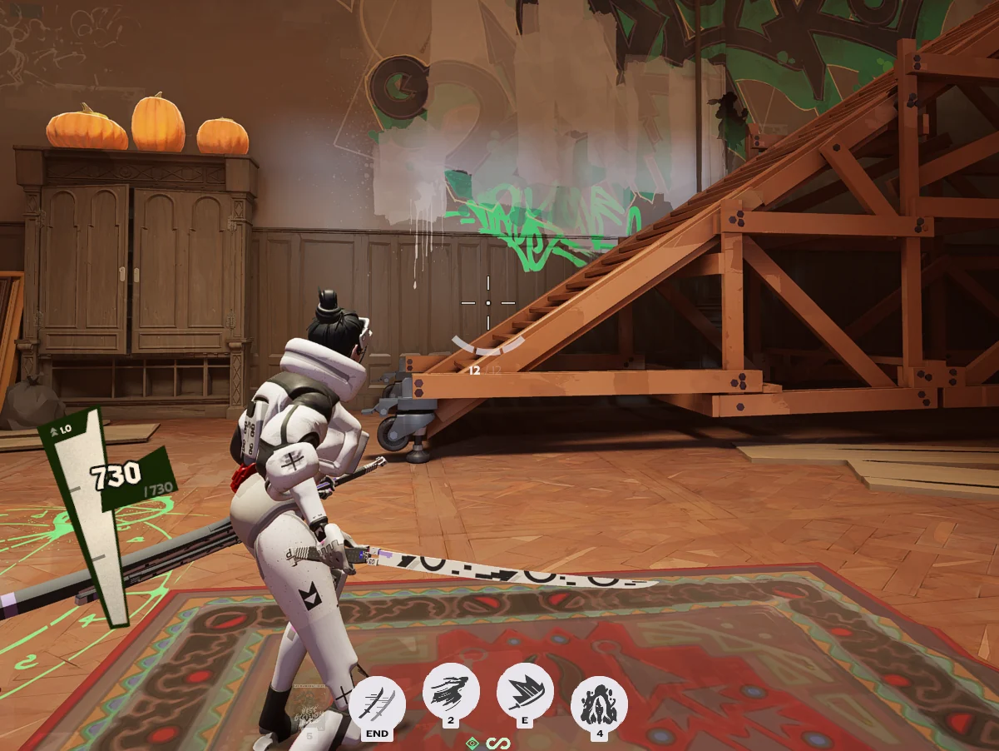
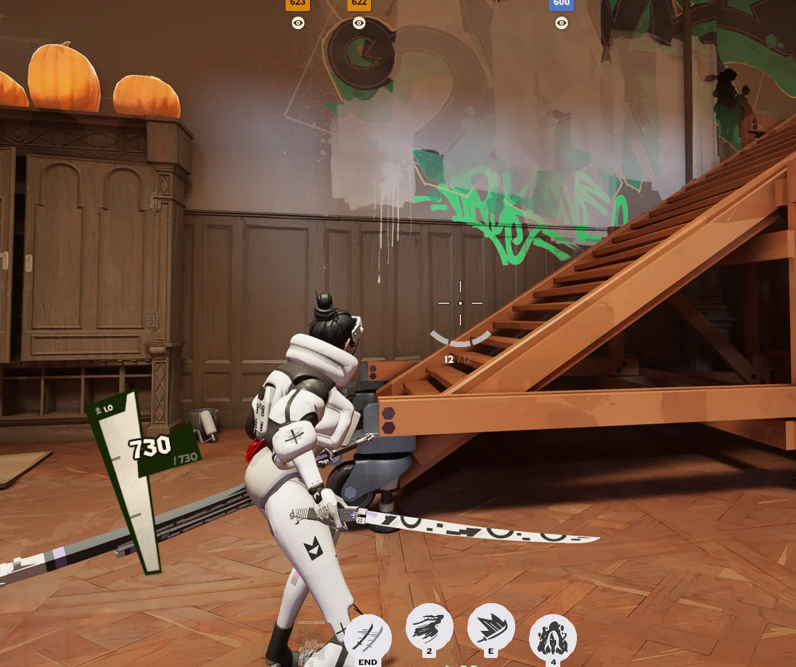
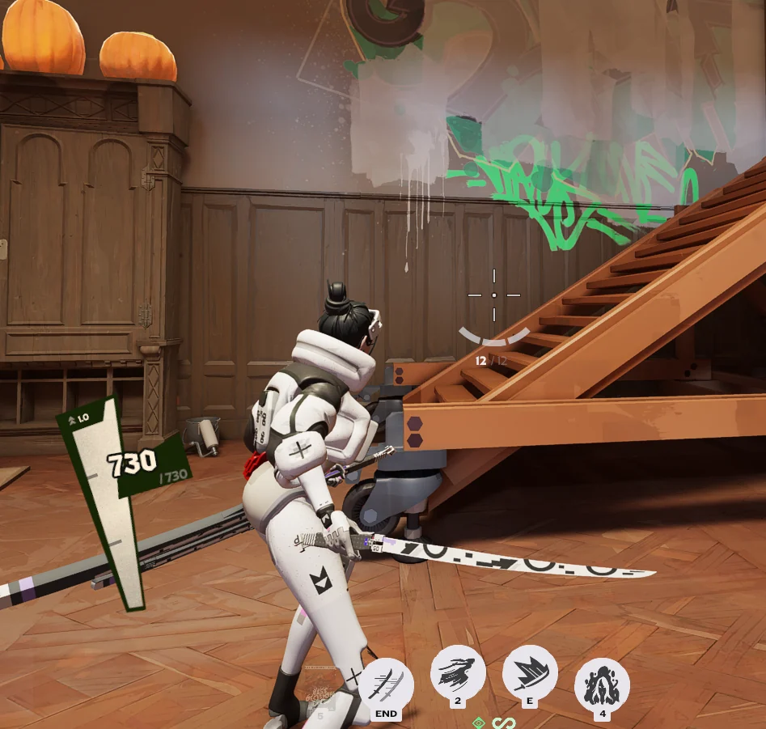

# Marathon Thief for Yamato

Turns Yamato into Thief, the Marathon runner, with her full outfit, portraits and voice.

## Downloads
- **[Default](https://github.com/Vyrena/marathon-thief-yamato/releases/latest/download/Thief_Default_Yamato.zip)**: Her standard Marathon outfit: white puffer jacket, visor and black hair.
- **[endoFLEX](https://github.com/Vyrena/marathon-thief-yamato/releases/latest/download/Thief_endoFLEX_Yamato.zip)**: A synthetic look with green face plating, a charcoal jacket and blue eyes.
- **[White Rabbit](https://github.com/Vyrena/marathon-thief-yamato/releases/latest/download/Thief_WhiteRabbit_Yamato.zip)**: All white, with lavender hair, red eyeliner and a white-and-pink katana.
- **[Kasha Yōkai](https://github.com/Vyrena/marathon-thief-yamato/releases/latest/download/Thief_KashaYokai_Yamato.zip)**: Red armour, a full face mask and pale spiked hair. Comes with its own voice lines.
- **[Slick Getter](https://github.com/Vyrena/marathon-thief-yamato/releases/latest/download/Thief_SlickGetter_Yamato.zip)**: Pale grey jacket with slate-blue legs and gloves, and teal eyes.
- **[Trespass Protocol](https://github.com/Vyrena/marathon-thief-yamato/releases/latest/download/Thief_TrespassProtocol_Yamato.zip)**: Yellow puffer jacket, pale green hair and purple lips.
- **[Acid Abyss](https://github.com/Vyrena/marathon-thief-yamato/releases/latest/download/Thief_AcidAbyss_Yamato.zip)**: Lime jacket over charcoal, with a white painted face and blue lips.
- **[Midnight Decay](https://github.com/Vyrena/marathon-thief-yamato/releases/latest/download/Thief_MidnightDecay_Yamato.zip)**: Charcoal gear splashed with blue paint, with silver hair.
- **[Vox Nocturna](https://github.com/Vyrena/marathon-thief-yamato/releases/latest/download/Thief_VoxNocturna_Yamato.zip)**: Charcoal jacket with red trim and black hair.
- **[Achromatic Rush](https://github.com/Vyrena/marathon-thief-yamato/releases/latest/download/Thief_AchromaticRush_Yamato.zip)**: Black, white and grey from head to toe.

Each look is its own mod. Enable only one. **[Install guide](https://vyrena.github.io/marathon-thief-yamato/)**

## Install
1. Download the zip. Keep it zipped.
2. In [Deadlock Mod Manager](https://deadlockmods.app/), click **Add Local Mod**, drop the zip in and click **Add**.
3. In **Mods Library**, click **Enable**, then start the game with **Launch modded**.

Manual install, updating and troubleshooting: https://vyrena.github.io/marathon-thief-yamato/

## In game

## Credits
Made by Vyrena, with heavy AI assistance. Unofficial community port. Marathon, its characters and assets belong to Bungie. Deadlock belongs to Valve. Not affiliated with or endorsed by either.
